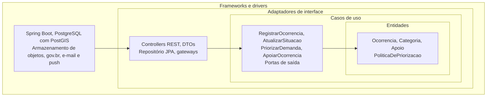

# 2. Arquitetura da Solução

Esta seção define a abordagem arquitetural do Neighborhood Action Dashboard e justifica a escolha. Ela é a base para as visões 4+1 da seção 3 e para a decisão registrada no [ADR-001](./05-adr/ADR-001-monolito-modular.md).

## 2.1 Abordagem escolhida

Escolhemos a **Clean Architecture** (MARTIN, 2019). O sistema é implantado como um monólito modular (ADR-001). A Clean completa se aplica ao módulo `ocorrencias`, onde está o domínio. O módulo `priorizacao` contém apenas domínio (cálculo puro, sem portas nem adaptadores). Os módulos `administracao` e `identidade` usam uma versão enxuta (caso de uso fino, sem entidades ricas), e `notificacoes` é reativo: responde a eventos de domínio.

| Abordagem | Escolha | Resumo |
|---|---|---|
| Camadas (Layered) | ☐ | Apresentação, negócio e dados, com dependência de cima para baixo |
| Hexagonal (Portas e Adaptadores) | ☐ | Núcleo isolado, com portas e adaptadores nas bordas (COCKBURN, 2005) |
| **Clean Architecture** | ☒ | Círculos concêntricos com dependência sempre para dentro |
| Onion | ☐ | Modelo de domínio no centro, com serviços de domínio e de aplicação ao redor (PALERMO, 2008) |

## 2.2 Círculos aplicados ao domínio

Os círculos abaixo valem por inteiro para o módulo `ocorrencias`. O módulo `priorizacao` contém apenas domínio (cálculo puro, sem portas nem adaptadores). Em `administracao` e `identidade` a versão é enxuta (caso de uso fino, sem entidades ricas), e `notificacoes` é reativo: responde a eventos de domínio com um listener assíncrono. A seta indica "depende de".

| Círculo | Conteúdo neste projeto | Onde ficam as regras principais |
|---|---|---|
| Entidades | Ocorrencia, Categoria, Apoio, HistoricoStatus e o serviço de domínio PoliticaDePriorizacao. São classes Java puras, sem anotações de framework. | **RF03:** a Ocorrencia conhece as transições válidas do ciclo de status e exige justificativa. **RF04:** a PoliticaDePriorizacao calcula a pontuação (peso de risco da categoria + número de apoios + tempo em aberto). |
| Casos de uso | RegistrarOcorrencia, AcompanharOcorrencia, AtualizarSituacao, PriorizarDemanda, EncerrarSolicitacao, ApoiarOcorrencia e ConsultarPainel. Declaram as portas de saída: OcorrenciaRepository, GeocodificacaoGateway, ArmazenamentoDeArquivos, Notificador e Relogio. | **RF01:** o caso de uso orquestra o registro, aplica a regra de até 3 fotos e confere categoria e localização. Cada caso de uso é uma transação de negócio. |
| Adaptadores de interface | Controllers REST, DTOs e presenters, repositório JPA com entidades JPA próprias e mapper domínio ↔ JPA, gateways para os serviços externos. | **RF01:** formato e obrigatoriedade dos campos são validados no DTO (Bean Validation). A autorização por papel é verificada na entrada da API. |
| Frameworks e drivers | Spring Boot (Web, Security, Data JPA, Modulith), PostgreSQL com PostGIS, armazenamento de objetos S3-compatível, gov.br (OAuth2/OIDC), serviço de mapas e geocodificação, serviço de e-mail e push. | Nenhuma regra de negócio. Só configuração e montagem das peças. |

Regra de decisão para validações: o que depende só do formato do dado fica no DTO. O que depende do negócio fica na entidade ou no caso de uso.

## 2.3 Regra de dependência e inversão de dependência

**Regra de dependência.** O código-fonte só aponta para dentro. As entidades não conhecem casos de uso, controllers, JPA nem Spring.

**Inversão de dependência (DIP).** O caso de uso precisa gravar e notificar, mas não pode depender do banco nem do provedor de e-mail. A solução é declarar a interface no círculo de casos de uso e implementá-la no círculo externo.

| Caso de uso | Porta (círculo de casos de uso) | Implementação (círculo externo) |
|---|---|---|
| RegistrarOcorrencia (RF01) | OcorrenciaRepository | Adaptador de persistência com Spring Data JPA e Hibernate Spatial |
| RegistrarOcorrencia (RF01) | GeocodificacaoGateway | Gateway para o serviço de mapas e geocodificação |
| RegistrarOcorrencia (RF01) | ArmazenamentoDeArquivos | Gateway para o armazenamento de objetos |
| AtualizarSituacao (RF03, RF06) | Notificador | Publicação de evento de domínio com registro de publicação (outbox); o listener assíncrono envia o e-mail ou push |
| PriorizarDemanda em `ocorrencias` (RF04) | Relogio | Relógio do sistema; o caso de uso passa o instante a `priorizacao`. Nos testes, um relógio fixo para validar o "tempo em aberto" |

Duas consequências práticas:
- As regras de RF03 e RF04 rodam em testes unitários sem Spring e sem banco.
- Trocar o provedor de e-mail ou o serviço de mapas altera só o adaptador correspondente.

O Spring injeta as implementações apenas na configuração da borda. O domínio nunca usa injeção de dependência do framework. Entidades de domínio e entidades JPA são classes separadas, ligadas por um mapper.

## 2.4 Justificativa da decisão

**Decisão:** adotar a Clean Architecture dentro do monólito modular.

| Aspecto | Descrição |
|---|---|
| **Motivação** | As regras do negócio (RF03, RF04, RF01) precisam ser independentes de framework, banco e interface, com cobertura ≥ 80% (RNF06). A stack combina Spring, JPA e serviços externos que podem mudar (RNF02, RNF03). |
| **Benefícios** | Domínio testável sem infraestrutura (RNF06). Troca de banco, provedor de identidade ou serviço de e-mail sem tocar nas regras. Casos de uso nomeados que espelham os requisitos (RF01 a RF08), o que facilita a rastreabilidade. Fronteira clara para o Spring Modulith verificar as dependências entre módulos. |
| **Limitações** | Mais código: interfaces, DTOs e mappers entre entidades de domínio e JPA. Curva de aprendizado para uma equipe de 2 integrantes. Risco de excesso de cerimônia em casos simples, como o CRUD de categorias (RF07). |
| **Como reduzimos o custo** | Um monólito (sem rede entre módulos), sem broker de mensagens e com portas apenas para dependências externas reais (persistência, mapas, arquivos, notificação e tempo). A versão enxuta da Clean em `administracao` e `identidade` evita cerimônia em CRUD (RF07). |

Clean, Hexagonal e Onion são da mesma família: todas apontam as dependências para o domínio. Camadas é a única de outra família.

| Alternativa descartada | Motivo do descarte |
|---|---|
| Camadas | A camada de negócio depende da camada de dados, e o ORM acaba entrando nas regras. Testar RF03 e RF04 exigiria banco e framework, o que fere o RNF06. |
| Hexagonal | Isola o núcleo por portas e adaptadores e protegeria o domínio de forma equivalente. Preferimos a Clean porque ela separa explicitamente as entidades dos casos de uso nomeados pelos RF e formaliza a regra de dependência entre círculos. Isso mapeia direto para a Visão Lógica e para a Visão de Desenvolvimento. O custo extra é parecido. |
| Onion | Tem serviços de aplicação equivalentes aos casos de uso e também protege o domínio. O critério de desempate é o mesmo: a Clean formaliza a regra de dependência e adota a nomenclatura de casos de uso que usamos na rastreabilidade e nos testes. É uma alternativa defensável, descartada por organização e não por capacidade técnica. |

## 2.5 Perguntas norteadoras

| Pergunta | Resposta |
|---|---|
| Quais atributos de qualidade são mais críticos? | Os mais críticos são a manutenibilidade (RNF06), a segurança (RNF02, RNF03) e o desempenho (RNF01: p95 ≤ 200 ms sob 100 req/s). A Clean favorece a **testabilidade**: o domínio é Java puro, o Relogio é injetável e as regras de RF03 e RF04 rodam em testes sem Spring e sem banco. Para a **escalabilidade**, a API é stateless com JWT, o que permite várias instâncias atrás de um balanceador. As fronteiras entre módulos, verificadas pelo Spring Modulith, permitem extrair um módulo no futuro (ADR-001). |
| Como as regras de negócio ficam separadas de interface, banco e integrações? | Regras em entidades e casos de uso (classes Java puras). Interface, banco e integrações ficam em adaptadores que implementam as portas. Os dados atravessam as fronteiras como DTOs. |
| Que complexidade extra a abordagem traz para a equipe e o prazo? | Cada caso de uso traz artefatos extras: controller, DTO, caso de uso, porta, adaptador e mapper domínio ↔ JPA. Para uma equipe de 2 integrantes e um prazo curto, isso aumenta o volume de código e exige disciplina com a regra de dependência. Mitigamos com um monólito (sem rede entre módulos), sem broker de mensagens, portas só para dependências externas reais e a versão enxuta da Clean em `administracao` e `identidade`. |
| Por que cada alternativa foi descartada? | **Camadas:** a camada de negócio depende da de dados e o ORM entra nas regras, o que impede testar RF03 e RF04 sem banco (RNF06). **Hexagonal e Onion:** são da mesma família da Clean e protegeriam o domínio de forma equivalente. Perderam porque a Clean separa explicitamente as entidades dos casos de uso nomeados pelos RF e formaliza a regra de dependência. |
| Como a escolha se conecta às visões 4+1? | A Visão Lógica mostra as entidades do círculo central e a Visão de Desenvolvimento mostra os módulos e os círculos, com as dependências apontando para o domínio. A Visão de Processo mostra essas peças em execução (REST síncrono, notificação assíncrona e concorrência) e o Cenário +1 integra as três no fluxo Registrar ocorrência. |

**Sobre o RNF02:** a autenticação com gov.br (OAuth2/OIDC) e a validação do token JWT ficam no círculo externo. A autorização por papel é verificada na entrada da API, e as regras de posse (o Cidadão só vê os dados pessoais das próprias ocorrências, RF02) ficam nos casos de uso.

**Sobre o RNF01:** a abordagem acrescenta um mapeamento em memória por operação, cujo custo é pequeno perto das chamadas ao banco. O desempenho vem das consultas espaciais com índice no PostGIS, da paginação e do upload de fotos fora do caminho crítico (detalhado na Visão de Processo).

## 2.6 Ligação com as visões 4+1

A Clean Architecture sustenta as visões de Kruchten (1995) assim: a **Visão Lógica** mostra as entidades do círculo central e seus relacionamentos ([03.1](./03-visoes-4mais1/03.1-visao-logica.md)). A **Visão de Desenvolvimento** mostra os módulos e os círculos com as dependências apontando para o domínio ([03.2](./03-visoes-4mais1/03.2-visao-desenvolvimento.md)). A **Visão de Processo** mostra a execução em tempo de operação: o fluxo síncrono por REST, a notificação assíncrona e os pontos de concorrência ([03.3](./03-visoes-4mais1/03.3-visao-processo.md)). O **Cenário +1** integra as três visões no fluxo Registrar ocorrência ([03.4](./03-visoes-4mais1/03.4-cenario-mais1.md)). A Visão Física não é exigida neste trabalho.

**Requisitos atendidos:** RF01, RF02, RF03, RF04, RF06, RF07, RNF01, RNF02, RNF03, RNF06
