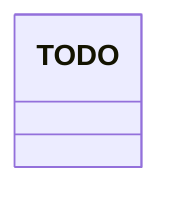

# 3.1 Visão lógica

Descreve as classes, pacotes e módulos e as funcionalidades percebidas pelo usuário final.

## Módulos principais
TODO: usar os mesmos nomes de componentes de `../02-arquitetura-da-solucao.md`.

## Diagrama de componentes

