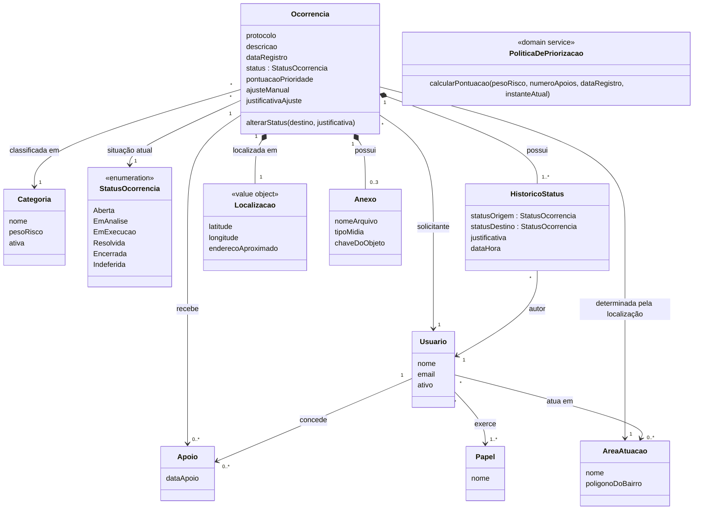
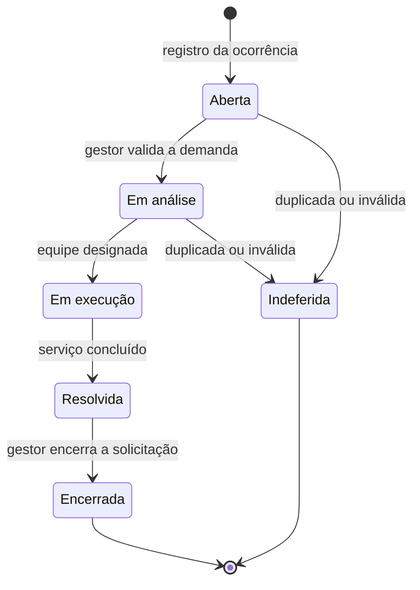

# 3.1 Visão Lógica

Esta visão apresenta o modelo de domínio do Neighborhood Action Dashboard: as entidades, seus relacionamentos e o ciclo de vida de uma ocorrência. Ela é o ponto de partida das demais visões da seção 3, que reutilizam os mesmos nomes.

## 3.1.1 O que a Visão Lógica representa

Na proposta de Kruchten (1995), a Visão Lógica descreve a funcionalidade que o sistema oferece ao usuário final, em forma de entidades e relacionamentos. Seu público é o usuário final e o analista, e a preocupação é "o que o sistema faz", não "como é executado" nem "onde está o código".

Na Clean Architecture (MARTIN, 2019), esta visão corresponde ao círculo de **Entidades** descrito na [seção 2.2](../02-arquitetura-da-solucao.md): classes Java puras, sem anotações de framework. As entidades JPA que gravam esses dados no PostgreSQL pertencem ao adaptador de persistência e não aparecem aqui.

## 3.1.2 Diagrama de classes

A pontuação é calculada por PoliticaDePriorizacao a pedido do caso de uso PriorizarDemanda, que lhe entrega apenas valores (D7); a entidade Ocorrencia não depende dela.

No relacionamento de `Usuario` com `AreaAtuacao` a multiplicidade é `0..*` porque só o Gestor Público tem área: ele atua em `1..*` áreas (RF07). O Cidadão e o Administrador não têm área de atuação.

## 3.1.3 Elementos do modelo

| Elemento | Tipo | Responsabilidade e regra principal | Requisitos |
|---|---|---|---|
| Ocorrencia | Entidade (raiz) | Representa a demanda registrada. Nasce com status Aberta e protocolo único. Conhece as transições válidas do ciclo de status e exige justificativa em toda mudança. Guarda a pontuação de prioridade e o ajuste manual do gestor, que também exige justificativa. **Invariante:** só é aceita se a localização estiver dentro de uma AreaAtuacao atendida; o tratamento da recusa é o fluxo alternativo A2 da [Etapa 4](../04-diagrama-sequencia.md). | RF01, RF02, RF03, RF04 |
| Usuario | Entidade | Pessoa autenticada pelo provedor de identidade gov.br. Atua como solicitante, autor de apoio ou autor de mudança de status. Concentra os dados pessoais, com acesso restrito e suporte à anonimização. | RF02, RF07, RNF03 |
| Papel | Entidade | Perfil de acesso: Cidadão, Gestor Público ou Administrador. Um usuário pode exercer mais de um papel. | RF07 |
| Categoria | Entidade | Tipo de demanda (por exemplo, iluminação pública). Guarda o peso de risco usado na priorização e é mantida pelo Administrador. | RF01, RF04, RF07 |
| StatusOcorrencia | Enumeração | Os seis valores do ciclo: Aberta, Em análise, Em execução, Resolvida, Encerrada e Indeferida. | RF03 |
| HistoricoStatus | Entidade | Registro imutável de cada transição: status de origem e de destino, justificativa, autor e data. O registro inicial (Aberta) é criado junto com a ocorrência. Alimenta a linha do tempo do cidadão. | RF02, RF03 |
| Apoio | Entidade | Adesão de um cidadão a uma ocorrência existente. Cada cidadão apoia uma ocorrência no máximo uma vez, e o número de apoios entra na pontuação. | RF04, RF08 |
| Localizacao | Objeto de valor | Latitude, longitude e endereço aproximado. Não tem identidade própria: vive e muda junto com a Ocorrencia. Base da consulta de duplicidade por raio. | RF01, RF08 |
| Anexo | Entidade | Foto da ocorrência, com no máximo 3 por ocorrência. Guarda só a referência (chave do objeto) ao armazenamento de objetos, nunca o arquivo. | RF01 |
| AreaAtuacao | Entidade | Bairro ou região, descrita por um polígono do bairro. A área de uma ocorrência é determinada pela sua localização. Também define o escopo de atuação dos gestores. | RF05, RF07 |
| PoliticaDePriorizacao | Serviço de domínio | Calcula a pontuação: peso de risco da categoria + número de apoios + tempo em aberto. Recebe apenas valores (peso de risco, número de apoios, data de registro e instante atual) e não conhece Ocorrencia nem Categoria (D7). Sem apoios, usa só o risco e o tempo em aberto. | RF04, RF08, RNF06 |

## 3.1.4 Ciclo de status da ocorrência (RF03)

O diagrama mostra os estados de uma Ocorrencia e as transições aceitas. Qualquer outra transição é rejeitada pela própria entidade.

| Transição | Quem executa | Regra |
|---|---|---|
| Registro → Aberta | Cidadão (RF01) | Cria o primeiro HistoricoStatus (Aberta). |
| Aberta → Em análise | Gestor Público | Justificativa obrigatória. |
| Em análise → Em execução | Gestor Público | Justificativa obrigatória. |
| Em execução → Resolvida | Gestor Público | Justificativa obrigatória, com evidência de resolução. |
| Resolvida → Encerrada | Gestor Público | Justificativa obrigatória. |
| Aberta ou Em análise → Indeferida | Gestor Público | Justificativa obrigatória. Não há transição depois de Indeferida. |

Toda transição válida gera um HistoricoStatus com autor e data (RF03) e dispara a notificação ao cidadão (RF06), tratada na [Visão de Processo](./03.3-visao-processo.md).

## 3.1.5 Decisões de modelagem

| Decisão | Motivação | Benefícios | Limitações | Alternativa descartada |
|---|---|---|---|---|
| StatusOcorrencia como enumeração | O conjunto de status é fixo e definido pelo negócio (RF03). | Transições verificadas pela entidade, sem consulta ao banco (RNF06). Modelo mais simples (KISS). | Novo status exige alterar o código. | Entidade configurável pelo Administrador: abre espaço para ciclos inválidos e não é pedida em nenhum RF. |
| Usuario e Papel muitos-para-muitos | Um gestor também pode registrar demandas como cidadão. | Uma conta por pessoa, com RBAC verificado por papel (RNF02). | Autorização precisa considerar o conjunto de papéis. | Papel único por usuário: forçaria duas contas para a mesma pessoa. |
| Localizacao como objeto de valor | A localização não tem identidade e não muda de forma independente da ocorrência. | Ciclo de vida único com a Ocorrencia e comparação por valor. Suporta a consulta por raio (RF08). | Uma localização compartilhada entre ocorrências é gravada duas vezes. | Entidade própria: cria identidade e repositório sem necessidade. |
| AreaAtuacao ligada à ocorrência pela localização | Filtro por bairro no painel e escopo do gestor. | Consulta do painel sem cálculo espacial a cada filtro (RF05, RNF01). | A associação precisa ser recalculada se o polígono de uma área mudar. | Calcular o bairro a cada consulta: custo repetido e pior desempenho. |
| HistoricoStatus como registro imutável | A trilha de transições é prova de auditoria. | Linha do tempo completa para o cidadão (RF02) e rastreabilidade das ações do gestor. | O volume de registros cresce com o uso. | Guardar só o status atual: perde justificativa, autor e data. |

## 3.1.6 Ligação com a Clean Architecture e com as demais visões

- **Clean Architecture.** O núcleo do módulo `ocorrencias` é Ocorrencia, Localizacao, Anexo, HistoricoStatus e Apoio, com a enumeração StatusOcorrencia. O módulo `priorizacao` contém PoliticaDePriorizacao. Categoria e AreaAtuacao pertencem ao módulo `administracao`, e Usuario e Papel ao módulo `identidade`, ambos em versão enxuta (decisão D6). Os relacionamentos que cruzam módulos (solicitante, autor, categoria e área) são referências por identificador, não por objeto. Os casos de uso orquestram as entidades e atravessam as fronteiras por DTOs.
- **Visão de Desenvolvimento ([03.2](./03.2-visao-desenvolvimento.md)).** Distribui estas entidades por módulo e por círculo.
- **Visão de Processo ([03.3](./03.3-visao-processo.md)).** Trata do que este modelo deixa de fora: a unicidade de Apoio por cidadão e ocorrência sob concorrência, o versionamento otimista da Ocorrencia e a notificação assíncrona.
- **Cenário +1 ([03.4](./03.4-cenario-mais1.md)).** Mostra como o registro de uma ocorrência cria Ocorrencia, Localizacao, Anexo e o primeiro HistoricoStatus.
- **Visão Física.** Não faz parte da entrega, conforme o enunciado.

**Requisitos atendidos:** RF01, RF02, RF03, RF04, RF05, RF07, RF08, RNF03, RNF06
