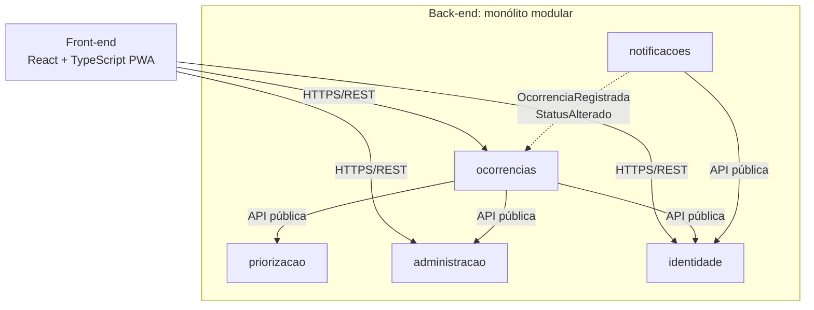
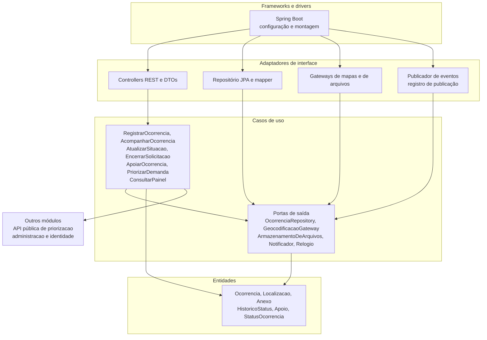

# 3.2 Visão de Desenvolvimento

Esta visão mostra como o código-fonte é organizado: os módulos do monólito, os círculos da Clean Architecture dentro de cada módulo e o sentido das dependências. Ela usa as entidades da [Visão Lógica](./03.1-visao-logica.md) e prepara a [Visão de Processo](./03.3-visao-processo.md).

## 3.2.1 O que a Visão de Desenvolvimento representa

Na proposta de Kruchten (1995), a Visão de Desenvolvimento descreve a organização estática do software no ambiente de desenvolvimento. Seu público são os desenvolvedores, e a preocupação é onde cada peça fica e quem pode depender de quem.

Aqui, a organização tem duas dimensões. Na horizontal, o back-end é um monólito modular (ADR-001) com cinco módulos por capacidade de negócio. Na vertical, cada módulo aplica os círculos da Clean Architecture (MARTIN, 2019) na medida definida pelas decisões D6 e D7. A Visão Física, que trataria da implantação, não é exigida neste trabalho.

## 3.2.2 Módulos e dependências

O front-end é um projeto separado do back-end. Dentro do back-end, a seta sólida indica chamada à API pública de outro módulo e a seta tracejada indica reação a eventos de domínio. Em ambos os casos, a seta aponta de quem depende para quem é dependido.

O grafo não tem ciclos. `priorizacao`, `administracao` e `identidade` não dependem de nenhum outro módulo. O módulo `ocorrencias` é o único que depende de três vizinhos, porque concentra o fluxo principal do sistema.

| Módulo | Responsabilidade | Aplicação da Clean | Dono de | O que expõe | Depende de | Requisitos |
|---|---|---|---|---|---|---|
| `ocorrencias` | Registrar, acompanhar, atualizar a situação, apoiar, encerrar e consultar no painel. Grava a pontuação de prioridade e faz o recálculo agendado pelo tempo em aberto. | Completa | Ocorrencia, Localizacao, Anexo, HistoricoStatus, Apoio, StatusOcorrencia | Eventos OcorrenciaRegistrada e StatusAlterado | `priorizacao`, `administracao`, `identidade` (API pública) | RF01, RF02, RF03, RF04, RF05, RF08 |
| `priorizacao` | Calcular a pontuação. Recebe peso de risco, número de apoios, data de registro e instante atual (Relogio) e devolve a pontuação. Não lê nem grava nada. | Entidades e API de cálculo, sem portas de saída nem adaptadores | PoliticaDePriorizacao | API de cálculo da pontuação | Nenhum módulo | RF04, RF08, RNF06 |
| `administracao` | Manter categorias com peso de risco, áreas de atuação e a atribuição de áreas aos gestores. | Enxuta (caso de uso fino) | Categoria, AreaAtuacao | API de consulta: categoria e seu peso de risco, área que contém uma localização e áreas de um gestor | Nenhum módulo | RF05, RF07 |
| `identidade` | Autenticar pelo gov.br, emitir o JWT próprio e o refresh token (D9), manter usuários e papéis e informar o contato do cidadão. | Enxuta (caso de uso fino) | Usuario, Papel | API de consulta: usuário autenticado com seus papéis e contato do cidadão | Nenhum módulo | RF07, RNF02, RNF03 |
| `notificacoes` | Enviar e-mail ou push quando a situação de uma ocorrência muda. | Reativa: listener assíncrono e adaptadores de envio, sem entidades ricas | Nenhuma entidade de domínio | Nada | `ocorrencias` (eventos), `identidade` (API pública) | RF06 |

Os eventos carregam só identificadores (ocorrência e destinatário). O contato do cidadão é consultado em `identidade` no momento do envio, para que dados pessoais não circulem nos eventos (RNF03).

| Evento | Publicado por | Consumido por | Quando | Requisitos |
|---|---|---|---|---|
| OcorrenciaRegistrada | `ocorrencias` | `notificacoes` | Depois do registro, com o status inicial Aberta. | RF01, RF06 |
| StatusAlterado | `ocorrencias` | `notificacoes` | Depois de cada transição válida do ciclo de status. | RF03, RF06 |

## 3.2.3 Círculos da Clean dentro de um módulo

O diagrama mostra o módulo `ocorrencias`, que aplica a Clean por inteiro. A seta indica "depende de" e todas apontam para o domínio. O Spring Boot só monta as peças na configuração.

| Círculo | Pacote no módulo | Conteúdo | Requisitos |
|---|---|---|---|
| Entidades | `ocorrencias.dominio` | Classes Java puras da Visão Lógica. A Ocorrencia aplica as transições válidas e exige justificativa. | RF03, RNF06 |
| Casos de uso | `ocorrencias.aplicacao` | Os sete casos de uso e as portas de saída. Cada caso de uso é uma transação de negócio. O PriorizarDemanda reúne as entradas, pede a pontuação a `priorizacao` e a grava. | RF01 a RF05, RF08 |
| Adaptadores de interface | `ocorrencias.adaptadores` | `web` (controllers e DTOs com Bean Validation), `persistencia` (entidades JPA, mapper e repositório), `gateways` (mapas e armazenamento de objetos) e `eventos` (publicação com registro de publicação). | RF01, RF06, RNF02 |
| Frameworks e drivers | Configuração da aplicação | Spring Boot, PostgreSQL com PostGIS, armazenamento de objetos, gov.br, serviço de mapas e serviço de e-mail e push. Montagem das implementações das portas. | RNF02 |
| API pública do módulo | Pacote raiz do módulo | Os eventos e as interfaces que outros módulos podem usar. Tudo o que está nos subpacotes é interno. | RNF06 |

A raiz dos pacotes do projeto é `br.com.fiap.nad`, e os pacotes citados acima ficam abaixo dela. Os módulos `priorizacao`, `administracao` e `identidade` seguem a mesma convenção, só com os círculos de que precisam. O módulo `priorizacao` tem apenas entidades e API de cálculo. Os módulos `administracao` e `identidade` têm um caso de uso fino por operação, sem entidades ricas. O módulo `notificacoes` tem um listener e os adaptadores de envio.

## 3.2.4 Front-end

O front-end React com TypeScript é um projeto separado, publicado como PWA. Ele se comunica com o back-end só por HTTPS/REST (RNF02) e não importa código do back-end. Organiza-se por funcionalidade: registrar, acompanhar, painel e administração. A responsividade e a acessibilidade (WCAG 2.1 AA, RNF05) são responsabilidade desse projeto e são verificadas nos testes end-to-end (seção 6).

## 3.2.5 Regras de dependência e como são verificadas

| Regra | Verificação |
|---|---|
| O código-fonte aponta para dentro: o domínio não conhece casos de uso, adaptadores nem Spring. | Teste de arquitetura no build (ex.: ArchUnit). |
| Entidades JPA existem só nos adaptadores de persistência. Entidades de domínio nunca chegam ao controller nem ao banco. | Teste de arquitetura no build. |
| Um módulo só usa a API pública ou os eventos de outro módulo, nunca seus subpacotes internos. | Verificação de estrutura do Spring Modulith, em teste. |
| Não há dependência cíclica entre módulos. | Verificação de estrutura do Spring Modulith, em teste. |
| `priorizacao` não depende de nenhum módulo. | Verificação do Spring Modulith, em teste. |

## 3.2.6 Decisões de organização

| Decisão | Motivação | Benefícios | Limitações | Alternativa descartada |
|---|---|---|---|---|
| Módulos por capacidade de negócio (ocorrencias, priorizacao, notificacoes, identidade e administracao) | Fronteiras que acompanham os requisitos e permitem extrair um módulo no futuro (ADR-001, RNF06). | Cada módulo tem responsabilidade clara e o Modulith verifica as fronteiras. | Exige disciplina para não usar subpacotes de outro módulo. | Pacotes por camada técnica (controllers, services, repositories): mistura todos os assuntos e esconde as fronteiras de negócio. |
| `priorizacao` como cálculo puro, sem dependências (D7) | A pontuação precisa de dados de `ocorrencias`. Se `priorizacao` os lesse, haveria ciclo entre os dois módulos. | Testável sem Spring e sem banco, com Relogio fixo (RF04, RNF06). Sem ciclos. | `ocorrencias` reúne as entradas, grava a pontuação e faz o recálculo agendado pelo tempo em aberto. | `priorizacao` dona da pontuação: cria dependência nos dois sentidos. Atualização por evento: a pontuação ficaria defasada logo após um apoio. |
| `notificacoes` reage a eventos, sem chamada direta | Uma falha no envio não pode impedir a mudança de status (RF06). | `ocorrencias` não conhece `notificacoes`. A tentativa de envio fica fora da transação do caso de uso. | A entrega é eventual, não imediata. A nova tentativa é tratada na Visão de Processo. | Chamada direta: acopla os módulos e propaga a falha de envio. Broker de mensagens: sobreengenharia para este porte. |
| Casos de uso chamam a API pública dos vizinhos sem porta própria. Cada API pública é exposta como interface Java. | Todos os módulos rodam no mesmo processo e o Modulith já verifica a fronteira. Portas só para dependências externas reais (KISS). A interface permite testar os casos de uso com dublês, sem subir o módulo vizinho (RNF06). | Menos interfaces e menos código para uma equipe de 2 integrantes, sem perder a testabilidade. | O caso de uso conhece o contrato do módulo vizinho. | Porta e adaptador anticorrupção por vizinho: mais cerimônia sem ganho no tamanho atual. |
| Front-end como projeto separado | O PWA responsivo (RNF05) evolui em ritmo diferente do back-end. | Contrato único por HTTPS/REST, sem código compartilhado. | Dois projetos para manter e um contrato de API para versionar. | Interface renderizada no servidor: acopla a interface ao back-end e dificulta o comportamento de PWA. |

**Requisitos atendidos:** RF01, RF02, RF03, RF04, RF05, RF06, RF07, RF08, RNF02, RNF03, RNF06
