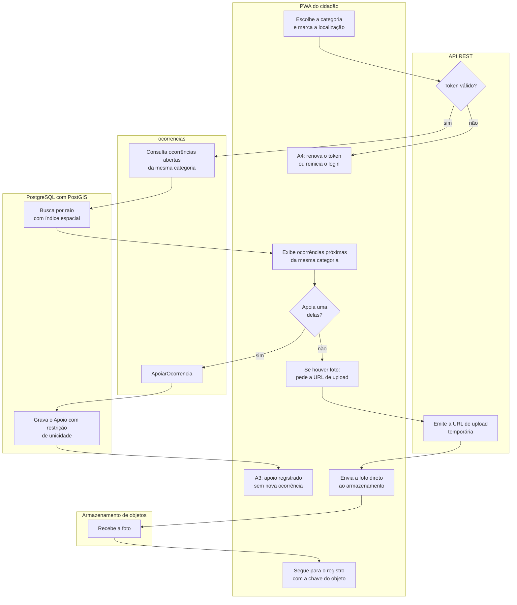
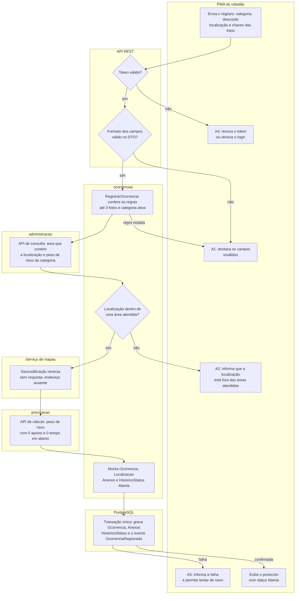
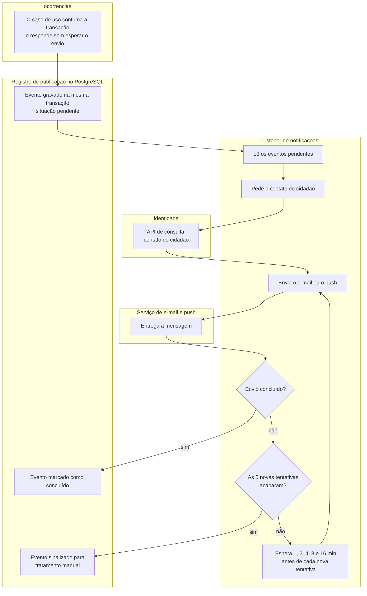

# 3.3 Visão de Processo

Esta visão descreve o sistema em execução: como as requisições e os eventos fluem, onde há concorrência e que medidas sustentam o desempenho e a disponibilidade. Ela usa os módulos da [Visão de Desenvolvimento](./03.2-visao-desenvolvimento.md) e as entidades da [Visão Lógica](./03.1-visao-logica.md).

## 3.3.1 O que a Visão de Processo representa

Na proposta de Kruchten (1995), a Visão de Processo trata dos aspectos dinâmicos: processos, comunicação, concorrência, desempenho e disponibilidade. Seu público são integradores e a operação. A preocupação é o que acontece ao mesmo tempo e o que acontece quando algo falha.

Os diagramas desta seção são fluxos com raias, uma por participante. Eles mostram decisões e ramos de falha, mas não detalham a troca de mensagens numeradas, que é o assunto do [diagrama de sequência](../04-diagrama-sequencia.md). A Visão Física, que trataria da implantação, não é exigida neste trabalho.

## 3.3.2 Unidades de execução e comunicação

| Unidade de execução | O que é | Observação |
|---|---|---|
| PWA do cidadão e do gestor | Aplicação React no navegador | Fala com a API por HTTPS/REST e, para fotos, direto com o armazenamento de objetos. |
| Instâncias da API | Processos do back-end (monólito modular) | Sem estado de sessão, com autenticação por token JWT emitido por `identidade`. Podem ser várias. |
| Listener assíncrono de `notificacoes` | Fila de trabalho dentro de cada instância | Lê o registro de publicação e envia as notificações fora da requisição. |
| Tarefa agendada de `ocorrencias` | Rotina periódica | Recalcula a pontuação pelo tempo em aberto. Roda em uma instância por vez. |
| PostgreSQL com PostGIS | Banco de dados | Guarda também o registro de publicação de eventos. |
| Sistemas externos | gov.br, serviço de mapas, serviço de e-mail e push, armazenamento de objetos | Detalhados na seção 3.3.8. |

| Canal | Entre | Tipo | Requisitos |
|---|---|---|---|
| HTTPS/REST | PWA e API | Síncrono | RNF02 |
| Chamada à API pública | Módulos no mesmo processo (`ocorrencias` com `priorizacao`, `administracao` e `identidade`) | Síncrono, dentro da transação do caso de uso | RF04, RF07 |
| Evento de domínio com registro de publicação | `ocorrencias` e `notificacoes` | Assíncrono | RF06 |
| URL temporária de upload | PWA e armazenamento de objetos | Síncrono, fora da API | RNF01 |
| OAuth2/OIDC, geocodificação e envio | API e serviços externos | Síncrono (login e geocodificação) e assíncrono (envio) | RNF02, RF01, RF06 |

## 3.3.3 Fluxo síncrono: registrar ocorrência (RF01)

O registro tem duas partes. A primeira acontece enquanto o cidadão preenche o formulário: consulta de duplicidade e envio de foto. A segunda é o registro em si, que termina em uma única transação. A consulta de duplicidade é prévia e não bloqueante (D8): o registro nunca é recusado por duplicidade, e o cidadão decide se apoia uma ocorrência existente. Esse desenho se encaixa nos 3 passos do RNF05: categoria e localização, descrição e fotos, confirmação.

### Preparação: duplicidade prévia (A3), apoio e upload de foto

### Registro: do envio à transação

Observações sobre o fluxo:
- A identidade do solicitante vem do token. O módulo `ocorrencias` obtém o usuário e seus papéis pela API pública de `identidade`.
- O `Relogio` é lido em `ocorrencias`, que passa o instante a `priorizacao` (D7). Na criação não há apoios nem tempo em aberto, então a pontuação inicial depende só do peso de risco.
- A geocodificação não impede o registro. Se o serviço de mapas não responder, a ocorrência é gravada só com latitude e longitude, sem o endereço aproximado.
- A foto é opcional. A API emite uma URL temporária, a PWA envia o arquivo direto ao armazenamento de objetos e a transação grava só a referência (D8). Os bytes da imagem nunca passam pela API.

### Ramos alternativos

| Ramo | Condição | Onde é detectado | Desfecho para o usuário | Requisitos |
|---|---|---|---|---|
| A1 | Campo obrigatório ausente ou fora do formato; mais de 3 fotos; categoria inativa | Formato no DTO da API. Regras de negócio no caso de uso. | Nada é gravado. A PWA destaca os campos inválidos. | RF01, RNF05 |
| A2 | Localização fora de qualquer AreaAtuacao atendida | Caso de uso, com a consulta à API de `administracao` | Nada é gravado. A mensagem explica que a região não é atendida. | RF01, RF07 |
| A3 | Existe ocorrência aberta da mesma categoria perto da localização | Consulta prévia, antes do registro | A PWA lista as ocorrências e oferece o apoio. Se o cidadão preferir, o registro segue, pois a consulta não bloqueia. | RF08 |
| A4 | Token inválido ou expirado | Entrada da API | A API recusa a requisição (401). A PWA tenta renovar com o refresh token, emitido por `identidade` e independente do gov.br. Se não conseguir, reinicia o login pelo gov.br. Sem o papel exigido, a resposta é 403. | RNF02 |
| A5 | Transação não confirmada | Banco de dados | Nada é gravado, nem a ocorrência nem o evento. A PWA pede para tentar de novo. A foto já enviada fica sem referência e é removida pela limpeza periódica de objetos sem referência. | RNF04 |

## 3.3.4 Fluxo assíncrono: notificação do cidadão (RF06)

A notificação não fica no caminho da requisição. O evento (OcorrenciaRegistrada ou StatusAlterado) é gravado no registro de publicação na mesma transação que muda o estado. Depois que a transação é confirmada, o cidadão já recebe a resposta, e o listener de `notificacoes` envia o aviso por conta própria. O evento carrega só identificadores. O contato do cidadão é consultado em `identidade` na hora do envio (RNF03).

| Aspecto | Comportamento |
|---|---|
| Falha no envio | A mudança de status já está confirmada e não é desfeita (RF06). O listener tenta de novo. |
| Política de tentativas | Depois da falha do primeiro envio, 5 novas tentativas com espera crescente de 1, 2, 4, 8 e 16 minutos antes de cada uma. Esgotadas as tentativas, o evento fica sinalizado para tratamento manual. |
| Garantia de entrega | Ao menos uma vez. Se a instância cair entre o envio e a marcação como concluído, o cidadão pode receber o aviso duas vezes. Para reduzir esses avisos duplicados, o listener registra o identificador do evento já enviado (chave de idempotência) e o consulta antes de enviar. |
| Várias instâncias | Cada evento é reservado por um bloqueio no banco enquanto está em processamento, para que só uma instância o envie. |

## 3.3.5 Concorrência

| Situação | Mecanismo | Resultado para o usuário | Requisitos |
|---|---|---|---|
| Dois cidadãos, ou o mesmo cidadão em dois dispositivos, apoiam a mesma ocorrência ao mesmo tempo | Restrição de unicidade por (cidadão, ocorrência) em Apoio, aplicada pelo banco | O segundo pedido recebe a resposta de que o apoio já existe. O apoio não é contado duas vezes. | RF08, RF04 |
| Dois gestores alteram o status da mesma ocorrência | Versionamento otimista da Ocorrencia: a gravação só vale se a versão lida ainda é a atual | O segundo gestor recebe um conflito, vê o status atual e decide de novo, com nova justificativa. | RF03 |
| Mudança de status e evento de notificação | Registro de publicação (outbox): o evento é gravado na mesma transação da mudança | Não existe status alterado sem evento, nem evento sem status alterado. | RF03, RF06 |
| Pontuação de prioridade | Recalculada no momento da escrita (novo apoio ou mudança) e por uma tarefa agendada pelo tempo em aberto. Ambas ficam em `ocorrencias`. `priorizacao` só calcula (D7). | A fila reflete o risco, os apoios e o tempo em aberto. Como a pontuação é derivada, a tarefa agendada corrige qualquer defasagem causada por escritas simultâneas. | RF04 |
| Tarefa agendada com várias instâncias | Bloqueio no banco: a instância que o obtém executa a rodada e as demais a ignoram | Cada rodada de recálculo roda uma única vez. | RF04, RNF04 |
| Recálculo agendado simultâneo a uma ação do gestor | O mesmo versionamento otimista: a gravação que perde relê a ocorrência e tenta de novo | O gestor só vê conflito se alterar a mesma ocorrência na janela do recálculo. | RF03, RF04 |

## 3.3.6 Desempenho (RNF01)

A meta é p95 ≤ 200 ms sob 100 requisições por segundo, sem contar o upload de fotos.

| Medida | Onde atua | Efeito | Requisitos |
|---|---|---|---|
| Índice espacial no PostGIS | Consulta prévia de duplicidade e busca da área que contém a localização | Consultas por raio e por área sem varrer a tabela inteira | RNF01, RF08 |
| Índices nos campos de filtro e paginação | Painel do gestor: lista em tabela e em mapa com filtros combináveis por bairro, categoria, status, prioridade e período | Cada resposta devolve uma página. Os indicadores usam os mesmos filtros da lista. | RF05, RNF01 |
| Upload de foto fora do caminho crítico | PWA direto ao armazenamento de objetos | A API não carrega os bytes da imagem. O upload fica fora da meta, como define o RNF01. | RNF01 |
| Pool de conexões | Acesso ao PostgreSQL | Dimensionado por teste de carga contra a meta do RNF01 | RNF01 |
| Cálculo da pontuação em memória | `priorizacao` | Sem consulta ao banco, o custo é pequeno perto de uma ida ao PostgreSQL | RF04 |
| Notificação assíncrona | Listener de `notificacoes` | O envio não entra no tempo de resposta da requisição | RF06, RNF01 |

## 3.3.7 Disponibilidade (RNF04)

Esta seção trata o tema só no plano conceitual. A meta é 99,5% ao mês, com RPO ≤ 24 h e RTO ≤ 4 h.

| Aspecto | Abordagem | Requisitos |
|---|---|---|
| Instâncias | A API não guarda estado de sessão e usa token JWT. Por isso várias instâncias podem atender atrás de um balanceador, e a perda de uma não derruba o serviço. | RNF04, RNF02 |
| Rotinas em segundo plano | O listener e a tarefa agendada coordenam as instâncias por bloqueio no banco. | RNF04 |
| Dados | Backup diário do PostgreSQL, o que sustenta o RPO ≤ 24 h. O procedimento de recuperação é documentado para sustentar o RTO ≤ 4 h. | RNF04 |
| Fotos | Ficam fora do banco, no armazenamento de objetos, o que reduz o volume do backup e da restauração. | RNF04 |
| Limitação | O PostgreSQL continua sendo um ponto único de falha em tempo de execução. Hoje a mitigação é o backup com RPO e RTO definidos. A réplica fica como evolução futura. | RNF04 |

## 3.3.8 Sistemas externos e comportamento na falha

| Sistema | Interação | Se falhar | Impacto para o usuário |
|---|---|---|---|
| Provedor de identidade gov.br (OAuth2/OIDC) | Síncrona, só no login. O gov.br apenas autentica. O JWT (15 minutos, com os papéis do RBAC) e o refresh token são emitidos por `identidade` (D9). | Só novos logins são afetados. As sessões existentes continuam sendo renovadas, porque a renovação não depende do gov.br. | Login indisponível para quem não está autenticado. Quem já está dentro não é afetado. |
| Serviço de mapas e geocodificação | Síncrona: exibição do mapa na PWA e geocodificação reversa no registro | A ocorrência é registrada com latitude e longitude, sem endereço aproximado. Se o mapa não carregar, o cidadão ainda pode informar a localização pelo GPS do dispositivo. | O registro continua possível, com menos informação de endereço. |
| Serviço de e-mail e push | Assíncrona, pelo listener | Novas tentativas e, depois, tratamento manual (seção 3.3.4). A mudança de status não é afetada. | Aviso atrasado ou, no pior caso, tratado manualmente. |
| Armazenamento de objetos | Síncrona, no envio e na exibição da foto | Se o envio falhar, o cidadão registra sem foto, com aviso. Se a exibição falhar, o texto da ocorrência continua disponível. | Foto ausente, o restante do fluxo funciona. |

## 3.3.9 Decisões de processo

| Decisão | Motivação | Benefícios | Limitações | Alternativa descartada |
|---|---|---|---|---|
| Versionamento otimista da Ocorrencia | Dois gestores podem alterar o mesmo status (RF03). Conflitos são raros. | Sem bloqueio de linha durante a edição. Boa convivência com várias instâncias. | O segundo gestor precisa refazer a ação. O recálculo agendado também altera a ocorrência e pode causar um conflito eventual. | Bloqueio pessimista: segura a ocorrência enquanto a tela está aberta e cria contenção. |
| Evento no registro de publicação e listener assíncrono | A falha no envio não pode impedir a mudança de status (RF06). | Consistência entre o status e o evento. Sem broker. | Entrega ao menos uma vez e com atraso. A chave de idempotência reduz os avisos duplicados. | Chamada direta ao serviço de e-mail: propaga a falha. Broker de mensagens: sobreengenharia para este porte. |
| Upload de foto direto ao armazenamento por URL temporária (D8) | A foto pesa mais que qualquer outro dado e o RNF01 exclui o upload da meta. | A API fica leve e o tempo de resposta do registro não depende da foto. | A URL temporária precisa ser emitida e expira. Se o registro falhar, a foto fica sem referência, e uma limpeza periódica remove os objetos sem referência. | Upload pela própria API: ocupa conexões e memória da API com arquivos. |
| Consulta de duplicidade prévia e não bloqueante (D8) | O RF08 pede para oferecer o apoio, não para impedir o registro. | O cidadão decide com informação. Registros legítimos nunca são recusados. | Duplicidades ainda podem ser registradas. O gestor trata como Indeferida (RF03). | Bloquear o registro por duplicidade: recusa casos legítimos e frustra o cidadão. |
| Recálculo na escrita e por tarefa agendada, em `ocorrencias`, com bloqueio no banco (D7) | A pontuação depende do tempo, que passa sem nenhuma escrita (RF04). | Fila atualizada sem ciclo entre módulos. Cada rodada roda uma só vez. | Depende do bloqueio no banco e da tarefa estar ativa. | Recalcular em toda leitura: custo alto no painel. Instância dedicada à tarefa: ponto único de falha. |

## 3.3.10 Ligação com as outras visões

- **[Visão Lógica (03.1)](./03.1-visao-logica.md).** A restrição de unicidade protege a regra "um apoio por cidadão por ocorrência" de Apoio. O versionamento otimista protege o ciclo de status da Ocorrencia. O evento carrega o status que gerou o HistoricoStatus.
- **[Visão de Desenvolvimento (03.2)](./03.2-visao-desenvolvimento.md).** Os fluxos usam as mesmas fronteiras: `ocorrencias` chama as APIs públicas de `priorizacao`, `administracao` e `identidade`, e `notificacoes` reage aos eventos OcorrenciaRegistrada e StatusAlterado.
- **[Cenário +1 (03.4)](./03.4-cenario-mais1.md).** O cenário Registrar ocorrência reúne os fluxos desta visão com as demais, sem repetir a sequência de mensagens da [Etapa 4](../04-diagrama-sequencia.md).

**Requisitos atendidos:** RF01, RF03, RF04, RF05, RF06, RF08, RNF01, RNF02, RNF04
