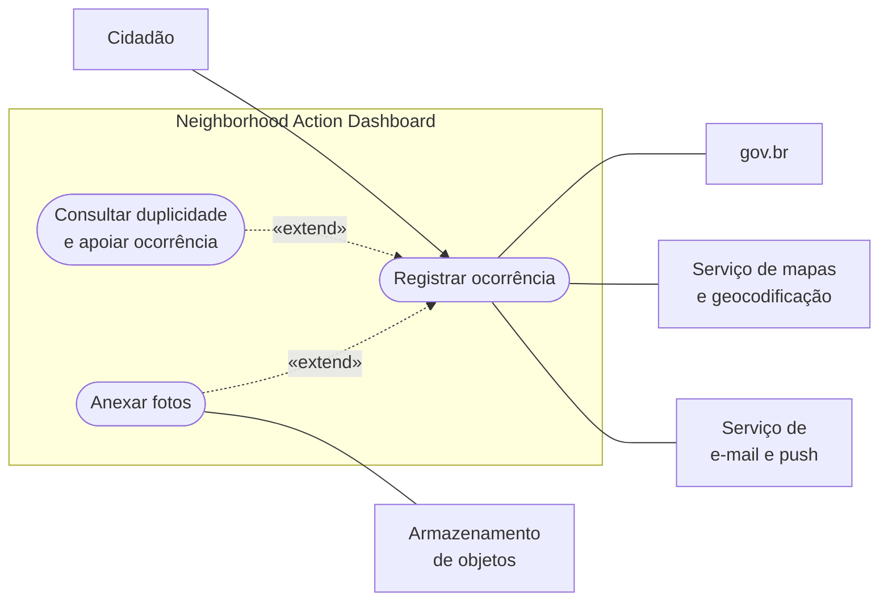

# 3.4 Cenário +1

Esta seção usa o caso de uso Registrar ocorrência para mostrar que as visões Lógica, de Desenvolvimento e de Processo se sustentam entre si. Ela não repete o fluxo mensagem a mensagem, que está no [diagrama de sequência](../04-diagrama-sequencia.md).

## 3.4.1 O que o Cenário +1 representa

Na proposta de Kruchten (1995), o "+1" é um conjunto de cenários, normalmente casos de uso, que reúne as outras quatro visões. Ele serve para descobrir lacunas e para validar a arquitetura: se o cenário atravessa as visões sem exigir um elemento que não existe, as visões são coerentes. Escolhemos o fluxo crítico Registrar ocorrência (D3), porque ele passa por todos os módulos, pelas integrações externas e pelos dois modos de comunicação, síncrono e assíncrono.

## 3.4.2 Caso de uso Registrar ocorrência (RF01)

| Campo | Descrição |
|---|---|
| Ator primário | Cidadão |
| Atores de apoio | gov.br (autenticação), serviço de mapas e geocodificação, armazenamento de objetos, serviço de e-mail e push |
| Pré-condições | O cidadão está autenticado, com JWT emitido por `identidade` (D9) e papel Cidadão. Existem Categoria ativa e AreaAtuacao cadastrada para a região, mantidas pelo Administrador. |
| Pós-condição de sucesso | Existe uma Ocorrencia com status Aberta, protocolo único, Localizacao, Anexos (de 0 a 3), HistoricoStatus inicial e pontuação inicial. O evento OcorrenciaRegistrada está no registro de publicação. O cidadão vê o protocolo e recebe depois uma confirmação com o protocolo. |
| Pós-condição de falha | Nada é gravado. A ocorrência e o evento nascem juntos ou não nascem. |
| Fluxos alternativos | A1 dados inválidos. A2 localização fora de área atendida. A3 duplicidade, na consulta prévia. A4 token inválido ou expirado. A5 falha ao salvar. Os desfechos estão na [seção 3.3.3](./03.3-visao-processo.md). |

| Passo | Ator | Ação |
|---|---|---|
| 1 | Cidadão | Escolhe a categoria e marca a localização no mapa ou pelo GPS. |
| 2 | Sistema | Mostra as ocorrências abertas da mesma categoria perto da localização e oferece o apoio (RF08). O cidadão pode ignorar e seguir. |
| 3 | Cidadão | Descreve a demanda e, se quiser, anexa até 3 fotos. |
| 4 | Cidadão | Confirma o registro. |
| 5 | Sistema | Valida os dados, confere a área atendida, calcula a pontuação inicial e grava tudo em uma única transação. |
| 6 | Sistema | Devolve o protocolo e o status Aberta. |
| 7 | Sistema | Envia, de forma assíncrona, a confirmação do registro com o protocolo (RF06). |

Os passos acima descrevem o caso de uso e não correspondem às mensagens numeradas da Etapa 4. O registro cabe nos 3 passos do RNF05: categoria e localização (passos 1 e 2), descrição e fotos (passo 3) e confirmação (passos 4 a 6).

## 3.4.3 Como cada visão sustenta o cenário

| Visão | O que sustenta no cenário | Elementos usados e onde são definidos | Requisitos |
|---|---|---|---|
| Lógica ([03.1](./03.1-visao-logica.md)) | Define os dados criados e as regras que o registro precisa respeitar. | Ocorrencia com status Aberta, protocolo e pontuação. Localizacao como objeto de valor. De 0 a 3 Anexos. HistoricoStatus inicial (multiplicidade `1..*`). Referências a Usuario (solicitante), Categoria e AreaAtuacao. Invariante: só é aceita se a localização estiver em uma AreaAtuacao atendida (A2). | RF01, RF04, RNF03 |
| Desenvolvimento ([03.2](./03.2-visao-desenvolvimento.md)) | Define quem executa cada parte e por onde as dependências passam. | O caso de uso RegistrarOcorrencia em `ocorrencias` e as portas OcorrenciaRepository, GeocodificacaoGateway, ArmazenamentoDeArquivos, Notificador e Relogio. As APIs públicas de `administracao` (área e peso de risco) e `priorizacao` (pontuação). O identificador e os papéis do solicitante vêm do JWT emitido por `identidade` (D9). `notificacoes` reage ao evento OcorrenciaRegistrada. | RF01, RF04, RF06, RNF02 |
| Processo ([03.3](./03.3-visao-processo.md)) | Define como o fluxo se comporta em execução: ordem, concorrência, desempenho e falhas. | Validação do token na entrada (A4). Consulta prévia de duplicidade com índice espacial (A3). Upload da foto direto ao armazenamento por URL temporária. Transação única com a gravação do evento. Listener assíncrono com nova tentativa. Falha de cada sistema externo sem impedir o registro. | RF01, RF06, RF08, RNF01, RNF02, RNF04 |

A Visão Física não faz parte da entrega, por isso não tem linha na tabela.

## 3.4.4 Requisitos exercitados pelo cenário

| Requisito | Como o cenário o exercita |
|---|---|
| RF01 | É o próprio caso de uso: categoria, descrição, localização, até 3 fotos, protocolo e status Aberta. |
| RF04 | A pontuação inicial é calculada por `priorizacao` com o peso de risco da categoria, sem apoios e sem tempo em aberto. |
| RF06 | O evento OcorrenciaRegistrada dispara a confirmação do registro com o protocolo, com nova tentativa em caso de falha. |
| RF08 | A consulta prévia de duplicidade oferece o apoio a uma ocorrência próxima, sem bloquear o registro. |
| RNF01 | Índice espacial na consulta, upload fora do caminho crítico e meta de p95 ≤ 200 ms sob 100 req/s. |
| RNF02 | JWT de 15 minutos emitido por `identidade`, papel Cidadão verificado na entrada, HTTPS e validação do formato no DTO. |
| RNF03 | Só o cidadão e o gestor responsável veem os dados do solicitante. O evento carrega apenas identificadores. |
| RNF04 | Falha ao salvar não deixa dado parcial. Falhas de mapas, armazenamento e e-mail ou push não impedem o registro. |
| RNF05 | O registro cabe em 3 passos na PWA responsiva. |

O cenário serve de roteiro para o teste end-to-end do registro, descrito na seção 6.

**Requisitos atendidos:** RF01, RF04, RF06, RF08, RNF01, RNF02, RNF03, RNF04, RNF05
