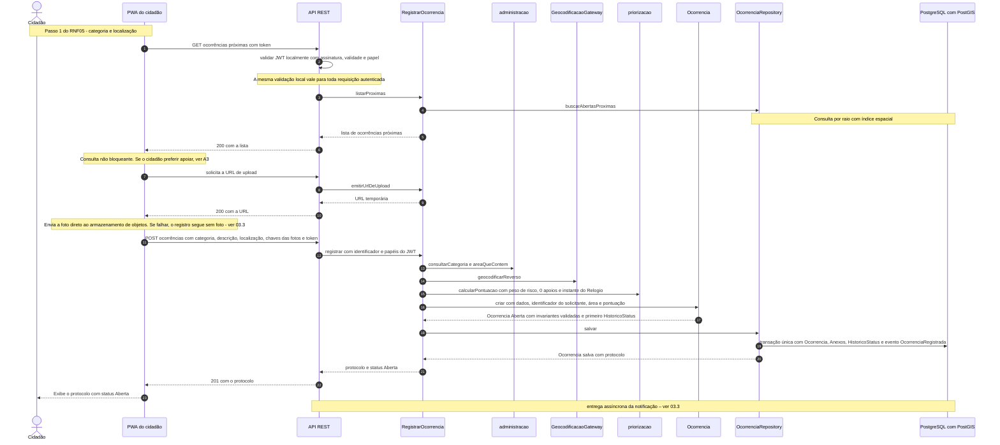
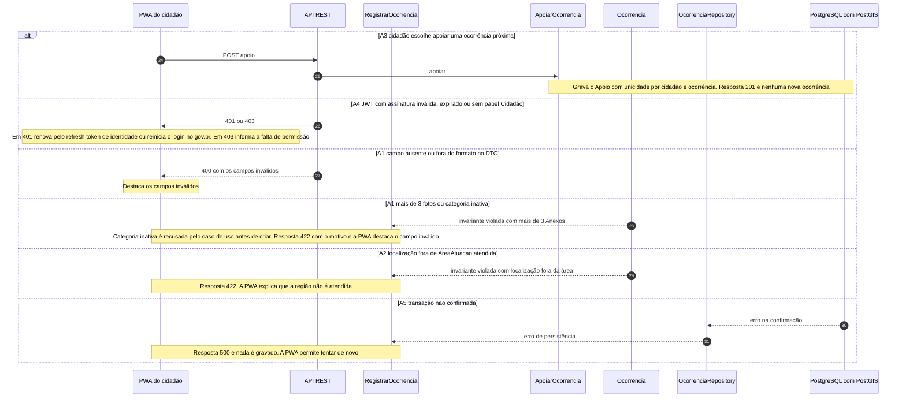

# 4. Cenário crítico e diagrama de sequência

Esta seção detalha, mensagem a mensagem, o fluxo crítico **Registrar ocorrência (RF01)**: quem chama quem e o que acontece em cada desvio. Os participantes usam os nomes da [Visão de Desenvolvimento](./03-visoes-4mais1/03.2-visao-desenvolvimento.md), e o fluxo segue a [Visão de Processo](./03-visoes-4mais1/03.3-visao-processo.md) sem repetir seus diagramas de raias.

## 4.1 Escopo

São dois diagramas com **numeração contínua de 1 a 31**: o fluxo principal (mensagens 1 a 23) e os fluxos alternativos A1 a A5 (mensagens 24 a 31). A consulta prévia de duplicidade e a emissão da URL de upload são operações preparatórias do caso de uso `RegistrarOcorrencia` (D8). O fluxo termina com o evento gravado e o protocolo exibido. A entrega da notificação fica fora da sequência.

| Item | Descrição |
|---|---|
| Ator | Cidadão autenticado (RF01) |
| Pré-condição | Sessão ativa: JWT de 15 minutos emitido por `identidade` após o login no gov.br (D9, RNF02) |
| Pós-condição de sucesso | Ocorrencia com status Aberta, protocolo único, Localizacao, de 0 a 3 Anexos, HistoricoStatus inicial e pontuação inicial gravados. Evento OcorrenciaRegistrada gravado na mesma transação. |
| Pós-condição de falha | Nada é gravado: nem a Ocorrencia nem o evento |

## 4.2 Participantes

| Participante | O que é | Papel no fluxo |
|---|---|---|
| Cidadão | Ator com papel Cidadão | Informa os dados e vê o protocolo. |
| PWA do cidadão | Aplicação React com TypeScript | Conduz os 3 passos do RNF05 e envia a foto direto ao armazenamento de objetos. |
| API REST | Controllers e DTOs com Bean Validation | Valida o JWT localmente (assinatura, validade e papel, D9), valida o formato e chama o caso de uso, repassando o identificador do solicitante e os papéis lidos do token. |
| RegistrarOcorrencia | Caso de uso de `ocorrencias` | Consulta duplicidade, emite a URL de upload, reúne os dados de `administracao`, mapas e `priorizacao`, pede a criação à Ocorrencia e a gravação ao repositório. |
| ApoiarOcorrencia | Caso de uso de `ocorrencias` | Aparece só no A3, quando o cidadão escolhe apoiar (RF08). |
| administracao | API pública do módulo | Informa a categoria com peso de risco e a AreaAtuacao que contém a localização. |
| GeocodificacaoGateway | Porta de saída, com adaptador para o serviço de mapas | Isola o serviço de mapas e geocodificação. |
| priorizacao | API pública do módulo, cálculo puro | Devolve a pontuação inicial e não lê nem grava dados (D7). |
| Ocorrencia | Entidade de domínio, classe Java pura | Valida as invariantes na criação (status Aberta, até 3 Anexos, localização em AreaAtuacao atendida) e produz o primeiro HistoricoStatus. É onde mora a regra de negócio. |
| OcorrenciaRepository | Porta de saída, com adaptador JPA | Grava a Ocorrencia e usa o mapper domínio ↔ JPA. |
| PostgreSQL com PostGIS | Banco de dados | Persiste os dados e o registro de publicação de eventos. |

Ficam fora da lista de participantes: `identidade`, que emite o JWT e o refresh token antes do fluxo e não é chamada durante o registro; o armazenamento de objetos, que só recebe a foto direto da PWA; o registro de publicação, gravado no PostgreSQL na mesma transação; e o módulo `notificacoes`, que age depois do fluxo. A cadeia respeita API REST → caso de uso → entidade → porta → adaptador → banco (MARTIN, 2019).

## 4.3 Diagrama 1 – Fluxo principal (mensagens 1 a 23)

Cada chamada síncrona a `administracao`, serviço de mapas e `priorizacao` devolve o dado ao caso de uso antes da chamada seguinte. Esses retornos não são desenhados.

| # | De | Para | Mensagem |
|---|---|---|---|
| 1 | PWA do cidadão | API REST | GET ocorrências próximas com token |
| 2 | API REST | API REST | Valida o JWT localmente com assinatura, validade e papel |
| 3 | API REST | RegistrarOcorrencia | listarProximas |
| 4 | RegistrarOcorrencia | OcorrenciaRepository | buscarAbertasProximas |
| 5 | RegistrarOcorrencia | API REST | Lista de ocorrências próximas |
| 6 | API REST | PWA do cidadão | 200 com a lista |
| 7 | PWA do cidadão | API REST | Solicita a URL de upload |
| 8 | API REST | RegistrarOcorrencia | emitirUrlDeUpload |
| 9 | RegistrarOcorrencia | API REST | URL temporária |
| 10 | API REST | PWA do cidadão | 200 com a URL |
| 11 | PWA do cidadão | API REST | POST ocorrências com categoria, descrição, localização, chaves das fotos e token |
| 12 | API REST | RegistrarOcorrencia | registrar com identificador e papéis do JWT |
| 13 | RegistrarOcorrencia | administracao | consultarCategoria e areaQueContem |
| 14 | RegistrarOcorrencia | GeocodificacaoGateway | geocodificarReverso |
| 15 | RegistrarOcorrencia | priorizacao | calcularPontuacao com peso de risco, 0 apoios e instante do Relogio |
| 16 | RegistrarOcorrencia | Ocorrencia | criar com dados, identificador do solicitante, área e pontuação |
| 17 | Ocorrencia | RegistrarOcorrencia | Ocorrencia Aberta com invariantes validadas e primeiro HistoricoStatus |
| 18 | RegistrarOcorrencia | OcorrenciaRepository | salvar |
| 19 | OcorrenciaRepository | PostgreSQL com PostGIS | Transação única com Ocorrencia, Anexos, HistoricoStatus e evento OcorrenciaRegistrada |
| 20 | OcorrenciaRepository | RegistrarOcorrencia | Ocorrencia salva com protocolo |
| 21 | RegistrarOcorrencia | API REST | Protocolo e status Aberta |
| 22 | API REST | PWA do cidadão | 201 com o protocolo |
| 23 | PWA do cidadão | Cidadão | Exibe o protocolo com status Aberta |

O JWT é validado localmente no controller (mensagem 2): assinatura, validade de 15 minutos e papel exigido, sem chamar `identidade` (D9). O identificador do solicitante e os papéis vêm do próprio token, e a Ocorrencia guarda o solicitante só por identificador, sem buscar dados pessoais (RNF03, seção 3.1.6). O evento também carrega só identificadores, e o contato do cidadão é consultado em `identidade` apenas no envio da notificação. Se o serviço de mapas não responder (mensagem 14), o registro continua sem o endereço aproximado (03.3).

## 4.4 Diagrama 2 – Fluxos alternativos A1 a A5 (mensagens 24 a 31)

Os ramos são excludentes e partem de pontos diferentes do fluxo principal. A tabela da seção 4.5 indica onde cada um acontece.

| # | De | Para | Mensagem |
|---|---|---|---|
| 24 | PWA do cidadão | API REST | [A3] POST apoio |
| 25 | API REST | ApoiarOcorrencia | [A3] apoiar |
| 26 | API REST | PWA do cidadão | [A4] 401 ou 403 |
| 27 | API REST | PWA do cidadão | [A1] 400 com os campos inválidos |
| 28 | Ocorrencia | RegistrarOcorrencia | [A1] Invariante violada com mais de 3 Anexos |
| 29 | Ocorrencia | RegistrarOcorrencia | [A2] Invariante violada com localização fora da área |
| 30 | PostgreSQL com PostGIS | OcorrenciaRepository | [A5] Erro na confirmação |
| 31 | OcorrenciaRepository | RegistrarOcorrencia | [A5] Erro de persistência |

## 4.5 Fluxos alternativos

Cada ramo tem uma condição de guarda e um desfecho claro. Os desfechos seguem a tabela de ramos da Visão de Processo.

| Ramo | Condição de guarda | Ponto de partida (mensagem) | Mensagens | Desfecho para o cidadão | Requisitos |
|---|---|---|---|---|---|
| A1 | Campo ausente ou fora do formato (DTO), mais de 3 fotos (invariante da Ocorrencia) ou categoria inativa (caso de uso) | 11, 13 e 16 | 27 e 28 | Nada é gravado. A PWA destaca os campos inválidos. | RF01, RNF05 |
| A2 | Localização fora de qualquer AreaAtuacao atendida (invariante da Ocorrencia) | 16 | 29 | Nada é gravado. A mensagem explica que a região não é atendida. | RF01 |
| A3 | Existe ocorrência aberta da mesma categoria perto da localização e o cidadão escolhe apoiar | 6 | 24 e 25 | O Apoio é gravado e nenhuma ocorrência nova é criada. Se o cidadão preferir, o registro segue, pois a consulta não bloqueia (D8). | RF08 |
| A4 | JWT com assinatura inválida, expirado ou papel sem permissão, verificado localmente no controller | 1, 7 e 11 | 26 | Resposta 401 ou 403. Em 401, a PWA renova pelo refresh token ou reinicia o login no gov.br (D9). Em 403, informa a falta de permissão. | RNF02 |
| A5 | Transação não confirmada | 19 | 30 e 31 | Nada é gravado, nem a Ocorrencia nem o evento. A PWA pede para tentar de novo. | RF01, RF06 |

## 4.6 Ligação com as demais visões

| Visão | O que o diagrama usa dela |
|---|---|
| [Lógica](./03-visoes-4mais1/03.1-visao-logica.md) | Ocorrencia nasce com status Aberta, protocolo e HistoricoStatus inicial, e valida a invariante da AreaAtuacao, que origina o ramo A2. |
| [Desenvolvimento](./03-visoes-4mais1/03.2-visao-desenvolvimento.md) | Participantes e sentido das dependências: controller, caso de uso, entidade, porta, adaptador e banco. `ocorrencias` chama as APIs públicas de `administracao` e `priorizacao`. |
| [Processo](./03-visoes-4mais1/03.3-visao-processo.md) | Consulta de duplicidade não bloqueante e upload por URL temporária (D8), tokens (D9), transação única com o evento e entrega assíncrona. O diagrama os traduz em mensagens numeradas. |
| [Cenário +1](./03-visoes-4mais1/03.4-cenario-mais1.md) | O mesmo caso de uso, visto pelo que cada visão contribui. |

**Requisitos atendidos:** RF01, RF04, RF06, RF08, RNF01, RNF02, RNF03, RNF05
