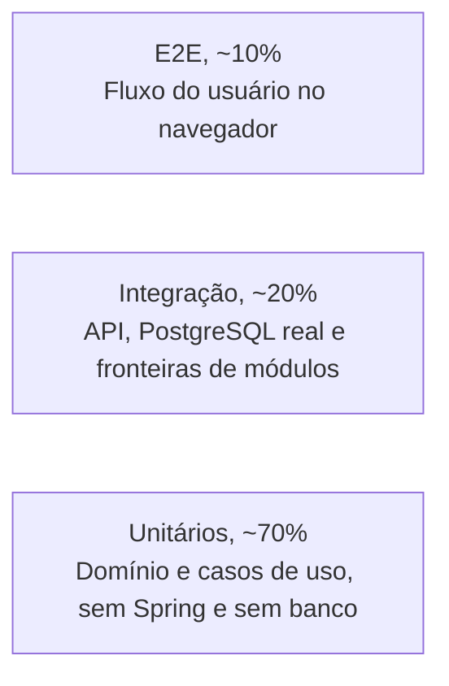

# 6. Qualidade e Testes

Esta seção apresenta a estratégia de testes: define como a equipe verifica as regras de negócio, a persistência e o fluxo do usuário, e quando uma entrega pode ser considerada pronta (Definition of Done).

## 6.1 Pirâmide de testes

A proporção é indicativa e segue o custo de cada nível (COHN, 2009): quanto mais alto, mais lento, mais caro de manter e mais frágil.

A base grande é possível por causa da Clean Architecture (MARTIN, 2019): entidades e casos de uso são classes Java puras, e as dependências externas entram por portas (OcorrenciaRepository, Relogio), que os testes substituem por dublês. É isso que viabiliza a independência de framework e a cobertura de 80% exigidas pelo RNF06. Ferramentas de referência: JUnit 5 e Mockito (unitários), Testcontainers (integração) e Playwright (E2E).

**Teste de carga (RNF01):** fora da pirâmide, porque mede desempenho e não comportamento. É feito de forma pontual antes da entrega, com 100 requisições por segundo, conferindo p95 ≤ 200 ms. Também dimensiona o pool de conexões descrito na [Visão de Processo](./03-visoes-4mais1/03.3-visao-processo.md).

## 6.2 Testes unitários

Rodam sem Spring e sem banco, em milissegundos. O tempo vem do Relogio (porta), sempre fixo no teste.

| # | Dado | Quando | Então | Req. |
|---|---|---|---|---|
| U1 | Ocorrencia com status Aberta | O gestor pede a transição para Resolvida | A transição é rejeitada, o status continua Aberta e nenhum HistoricoStatus é criado | RF03 |
| U2 | Relogio fixo e duas Ocorrencias da mesma categoria e do mesmo tempo em aberto, uma com mais apoios | PoliticaDePriorizacao calcula a pontuação das duas | A pontuação com mais apoios é maior | RF04 |
| U2b | Relogio fixo e Ocorrencia sem apoios (apoios = 0) | PoliticaDePriorizacao calcula a pontuação | A pontuação depende só do peso de risco e do tempo em aberto, sem erro | RF04 |
| U3 | Registro com 4 Anexos | A Ocorrencia é criada | A invariante de no máximo 3 anexos é violada e a criação é rejeitada | RF01 |
| U4 | Localizacao fora da AreaAtuacao informada | A Ocorrencia é criada | A invariante de localização é violada e a criação é rejeitada | RF01 |
| U5 | Cidadão que já apoiou a Ocorrencia | O mesmo cidadão apoia de novo | O segundo Apoio é rejeitado e o total de apoios não muda | RF08 |

## 6.3 Testes de integração

Sobem a aplicação com PostgreSQL + PostGIS reais em contêiner descartável. Não usam banco em memória, porque consultas espaciais e restrições de unicidade precisam do comportamento real.

| # | Verificação | Resultado esperado | Req. |
|---|---|---|---|
| I1 | A API de ocorrências grava uma Ocorrencia e a consulta de volta | Ocorrencia salva com status Aberta e protocolo único, devolvida na consulta pelo protocolo | RF01, RF02 |
| I2 | Gestor muda o status | HistoricoStatus e evento de domínio gravados na mesma transação. Em caso de rollback, nenhum dos dois existe | RF06, RF03 |
| I3 | Dois gestores alteram a mesma Ocorrencia a partir da mesma versão lida | A primeira gravação vale. A segunda recebe conflito e o status da primeira é preservado | RF03 |
| I4 | Verificação de estrutura do Spring Modulith | Sem ciclos, sem uso de subpacotes internos de outro módulo e `priorizacao` sem dependências (D7) | RNF06 |
| I5 | Cidadão autenticado tenta alterar o status de uma Ocorrencia. Em outro teste, tenta ver os dados pessoais de uma Ocorrencia de outro solicitante | A alteração de status devolve 403. A consulta aos dados pessoais é recusada pela regra de posse | RNF02, RF02 |

## 6.4 Testes end-to-end (E2E)

Percorrem a PWA e a API reais pelo navegador, só para os fluxos críticos.

| # | Cenário | Resultado esperado | Req. |
|---|---|---|---|
| E1 | Cidadão registra uma ocorrência. O gestor leva o status de Aberta até Encerrada, com justificativa em cada passo. O cidadão acompanha o resultado | Registro concluído em até 3 passos. Linha do tempo completa, em ordem cronológica. Notificação gerada a cada mudança | RF01, RF02, RF03, RF06, RNF05 |
| E2 | Verificação de acessibilidade nas telas de registro, acompanhamento e painel, em tela de celular e de desktop | Nenhuma violação da WCAG 2.1 AA (W3C, 2018) na verificação automatizada. Navegação por teclado revisada manualmente | RNF05 |

A verificação de WCAG e dos 3 passos cumpre o que a [seção 3.2.4](./03-visoes-4mais1/03.2-visao-desenvolvimento.md) atribui aos testes E2E do front-end.

## 6.5 Definition of Done

**Critério de cobertura:** domínio e aplicação com cobertura ≥ 80% (RNF06), conferida no relatório gerado na execução local dos testes. Não depende de ferramenta de pipeline.

| # | Critério | Evidência | Feito |
|---|---|---|---|
| 1 | Requisito e critérios de aceite validados | Critérios de aceite do requisito (seção 1.5) conferidos pelos dois integrantes. Ex.: RF03 só aceita transições válidas, coberto por U1 e E1 | [ ] |
| 2 | Testes unitários aprovados | Relatório do JUnit sem falhas, incluindo U1 a U5, e cobertura ≥ 80% em domínio e aplicação | [ ] |
| 3 | Testes de integração aprovados | I1 a I5 aprovados contra o PostgreSQL real. Ex.: I3 comprova o conflito de versão | [ ] |
| 4 | Fluxo principal em E2E | Relatório do Playwright com E1 aprovado, do registro ao encerramento | [ ] |
| 5 | Código revisado por outro integrante | Pull request aprovado pelo outro integrante antes do merge | [ ] |
| 6 | Decisão em ADR quando aplicável | ADR registrado em `docs/05-adr`. Ex.: extrair um módulo do monólito exigiria rever o ADR-001. Se não houver decisão nova, registrar "não se aplica" | [ ] |
| 7 | Sem defeitos críticos abertos | Lista de issues sem nenhum defeito crítico aberto | [ ] |
| 8 | Documentação atualizada | Seções de `docs/` e `contexto/rastreabilidade.md` atualizadas no mesmo pull request | [ ] |

**Requisitos atendidos:** RF01, RF02, RF03, RF04, RF06, RF08, RNF01, RNF02, RNF05, RNF06
